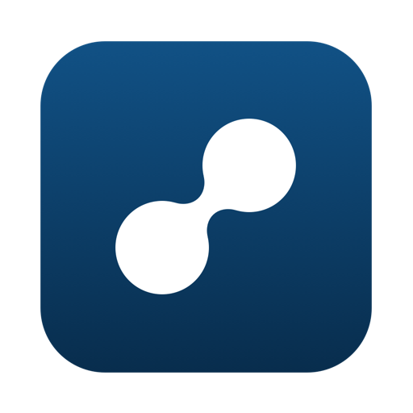

A small thing I built for myself: two Macs on the same desk, one clipboard, one keyboard. Slip syncs clipboard, files and (opt-in) keyboard and mouse between them over the LAN. Native Swift, lives in the menu bar, no account, no cloud.

Free to use. Open to anyone who wants to test it, run it, or <a href="https://github.com/psantalla/slip" target="_blank" rel="noopener noreferrer">poke at the repo</a> and collaborate. Apple Silicon only for now.

What it does:

- Clipboard text and images, both ways.
- Files, dropped into `~/Downloads/Slip`.
- KVM (opt-in, off by default): the cursor crosses the screen edge onto the other Mac, keyboard follows.
- Each part toggleable on its own.

A few calls by design:

- Native only. No Electron, no daemon, no dependencies.
- Secure by default: paired over TLS from a one-time code, no plaintext fallback. LAN only, same owner both ends.
- Light touch: polls only while connected, one connection, capped payloads.
- KVM stays gated: input is swallowed only while the cursor is remote, local always passes through, and a failsafe hands control back.

Scoped and terse on purpose: one feature solid before the next.
